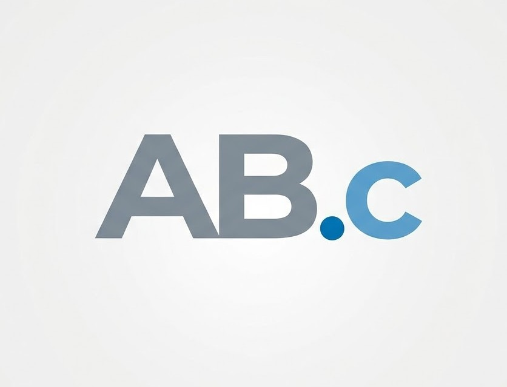

  

  # AB.c — Aprendizagem, Barreiras e Computação

  *Aprenda programação. Pense em acessibilidade. Crie para todos.*

  Universidade de Brasília (UnB) · Educação · Gratuito

   

  <!-- App Store Badges -->

  
  

    

  <!-- Action Button -->
  

   
  Disponível para Android · Instalação via pacote APK

---

## DESTAQUE DO PROJETO

> ***"Uma jornada inclusiva na ciência da computação."***  
> Desenvolvido por estudantes da **Universidade de Brasília (UnB)** para a disciplina de **Informática e Sociedade**, o **AB.c** transforma conceitos de programação em desafios visuais e práticos, promovendo a conscientização sobre acessibilidade digital no ensino médio.

---

## SOBRE ESTE APP

O **AB.c** é um aplicativo educacional criado para introduzir o raciocínio lógico e os fundamentos da programação de forma interativa, prática e socialmente consciente.

Como fruto dos debates e aprendizados na disciplina de **Informática e Sociedade (UnB)**, o app convida os estudantes a resolverem desafios práticos, integrando conceitos de acessibilidade digital e inclusão desde as primeiras linhas de código.

### RECURSOS PRINCIPAIS

* **`Fundamentos da Computação`** — Compreenda conceitos essenciais como *variáveis*, *tipos de dados*, *sintaxe* e *operações lógicas*.
* **`Estruturas de Controle`** — Pratique o uso de condicionais (`if` / `else`), operadores de comparação e manipulação de eventos.
* **`Acessibilidade Universal`** — Descubra na prática como projetar interfaces e softwares inclusivos para todas as pessoas.
* **`Estudo de Caso — Loja do Tonho`** — Aplique a lógica de programação em cenários práticos do dia a dia para resolver problemas operacionais e aprimorar a acessibilidade de um sistema comercial.

---

## GUIA DE INSTALAÇÃO

Por se tratar de um projeto acadêmico distribuído em formato **APK** fora da loja oficial, siga o procedimento de instalação abaixo:

  
  
  
  

 

1. **Obter:** Clique no botão *Obter o App* para efetuar o download do arquivo APK.
2. **Autorizar:** Nas configurações de segurança do seu dispositivo, permita a *Instalação de fontes desconhecidas*.
3. **Instalar:** Abra o pacote baixado e confirme a instalação.
4. **Iniciar:** Abra o aplicativo e comece a explorar os desafios.

---

## INFORMAÇÕES TÉCNICAS

| Especificação | Detalhe |
| :--- | :--- |
| **Desenvolvedor** | Estudantes da **Universidade de Brasília (UnB)** |
| **Disciplina** | **Informática e Sociedade** |
| **Tamanho** | ~65 MB |
| **Categoria** | Educação / Computação |
| **Compatibilidade** | Requer Android 7.0 ou posterior |
| **Idiomas** | Português |
| **Classificação** | Livre para todos os públicos |
| **Copyright** | © 2026 AB.c / UnB |
| **Preço** | Gratuito |

---

## AVALIAÇÕES E SUPORTE

A sua opinião nos ajuda a evoluir a experiência do aplicativo! Conte-nos sobre a sua jornada de aprendizado, sugestões de novos desafios ou relatos de uso.

* **Suporte do Desenvolvedor:** [redjp15@gmail.com](mailto:redjp15@gmail.com)

---

## NOSSA GALERIA

  
  
  
  
  

---

  ### Comece a codificar hoje mesmo

  

    
  <b>AB.c — Aprender, Brincar e Codificar.</b>

