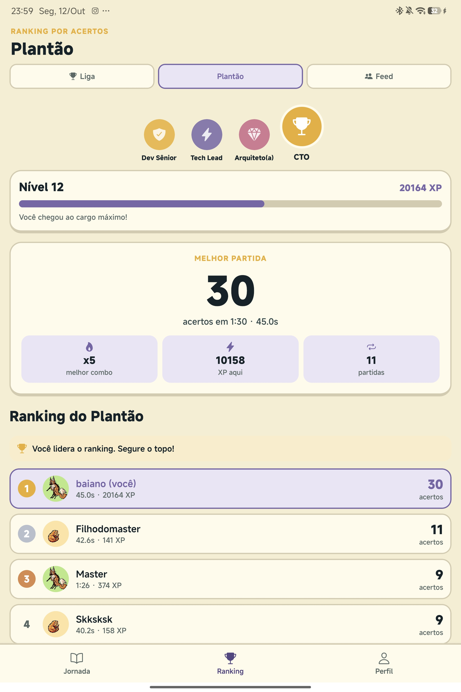
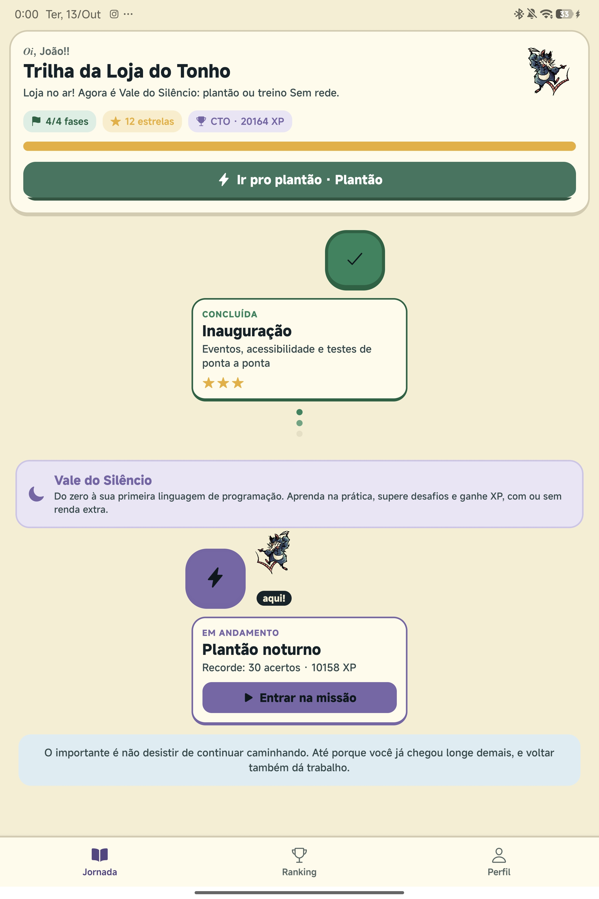
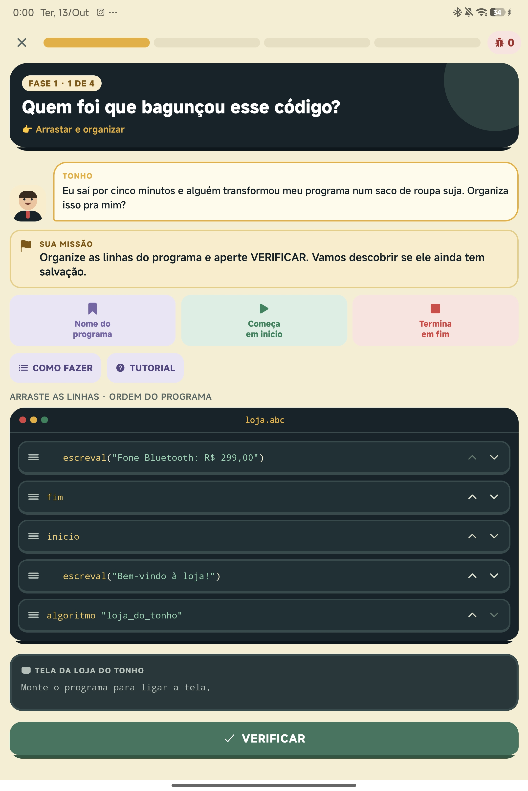
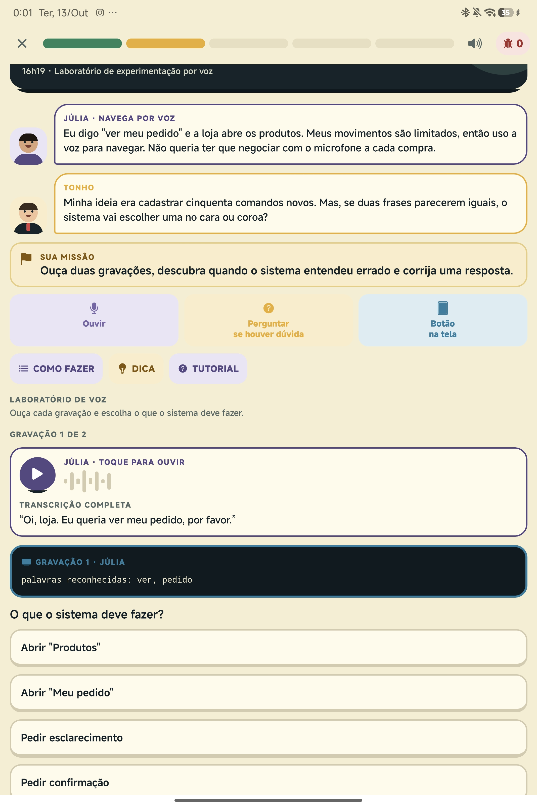

  

  # AB.c — Aprendizagem, Barreiras e Computação

  **Aprenda programação. Pense em acessibilidade. Crie para todos.**

  Um aplicativo educativo que transforma o ensino de lógica de programação em desafios interativos e acessíveis para estudantes do ensino médio.

   

  

   
  Android · Arquivo APK · Gratuito

---

## 📌 Sobre o Projeto

O **AB.c** foi desenvolvido por estudantes da **Universidade de Brasília (UnB)** como um projeto acadêmico focado na interseção entre **educação, computação e acessibilidade digital**. 

O objetivo central é ensinar conceitos introdutórios de programação de forma intuitiva e prática, conscientizando as novas gerações de desenvolvedores sobre a importância de criar tecnologias inclusivas desde as primeiras linhas de código.

---

## 📱 Interface do Aplicativo

  
  
  
  

---

## 🎯 Conteúdos e Metodologia

Inspirado na dinâmica de gamificação do *Duolingo*, o **AB.c** guia o estudante por trilhas e desafios práticos que estimulam o raciocínio lógico e a resolução de problemas do mundo real.

### 💡 O que você vai aprender:

- **Lógica e Fundamentos:** Instruções executáveis, variáveis, tipos de dados e operações.
- **Estruturas de Controle:** Condicionais (`if/else`), comparações, operadores lógicos e eventos.
- **Acessibilidade Digital:** Práticas e conceitos fundamentais para tornar sistemas compreensíveis e utilizáveis por pessoas com diferentes necessidades e deficiências.

> 🏬 **Caso Prático — Loja do Tonho:**  
> Os desafios incluem cenários reais como a *Loja do Tonho*, onde o usuário utiliza lógica de programação para resolver problemas operacionais e implementar melhorias diretas na acessibilidade do sistema.

---

## 📥 Como Instalar (Passo a Passo)

O **AB.c** é disponibilizado diretamente via pacote **APK** para dispositivos Android. Por não estar na Google Play Store, o Android pode exibir alertas padrão ao baixar ou instalar arquivos de fontes externas.

  
  
  
  

 

1. **Baixar o APK:** Clique no botão de download abaixo ou no topo do repositório.
2. **Permitir Instalação:** Se solicitado pelo Android, confirme a autorização para baixar/instalar aplicativos de fontes desconhecidas no seu navegador.
3. **Instalar:** Abra o arquivo baixado e toque em **Instalar**.
4. **Pronto!** Abra o aplicativo e comece a aprender.

 

  ### 🚀 Pronto para começar?

  

---

## 💬 Feedback e Contato

Sua opinião é fundamental para avaliarmos o impacto educativo e aprimorarmos as futuras versões do aplicativo!

Após testar o **AB.c**, compartilhe conosco:
- O que achou dos desafios e da trilha de aprendizado?
- Quais conceitos foram fáceis ou difíceis de compreender?
- Sugestões de novos cenários, bugs encontrados ou pontos de melhoria.

📧 **Contato por e-mail:** [redjp15@gmail.com](mailto:redjp15@gmail.com)

---

## 👥 Créditos e Realização

Projeto acadêmico desenvolvido por estudantes do curso de **Ciência da Computação** da **Universidade de Brasília (UnB)**.

  <b>AB.c — Aprender, Brincar e Codificar.</b>

