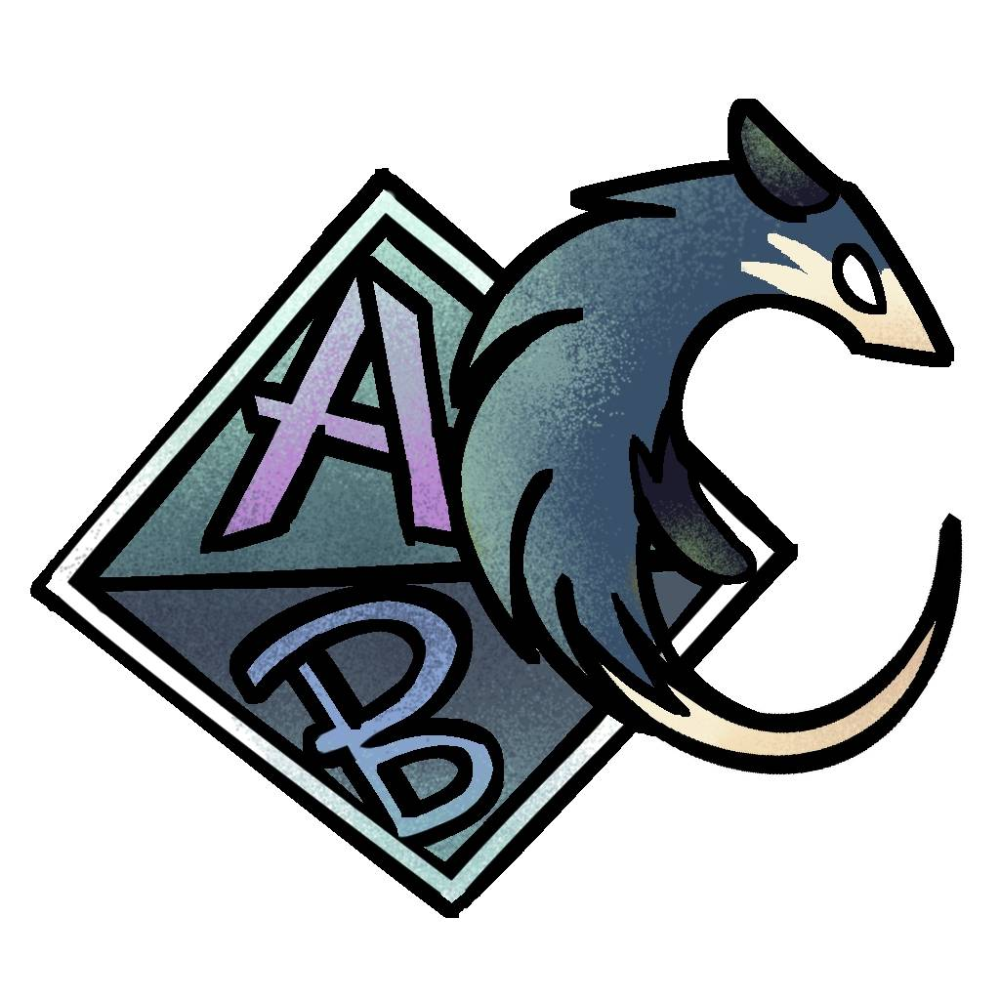
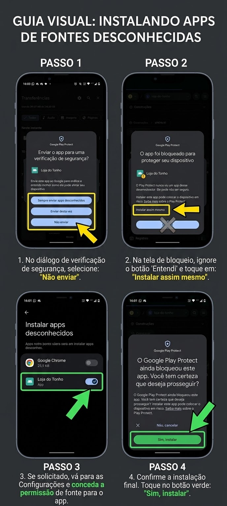
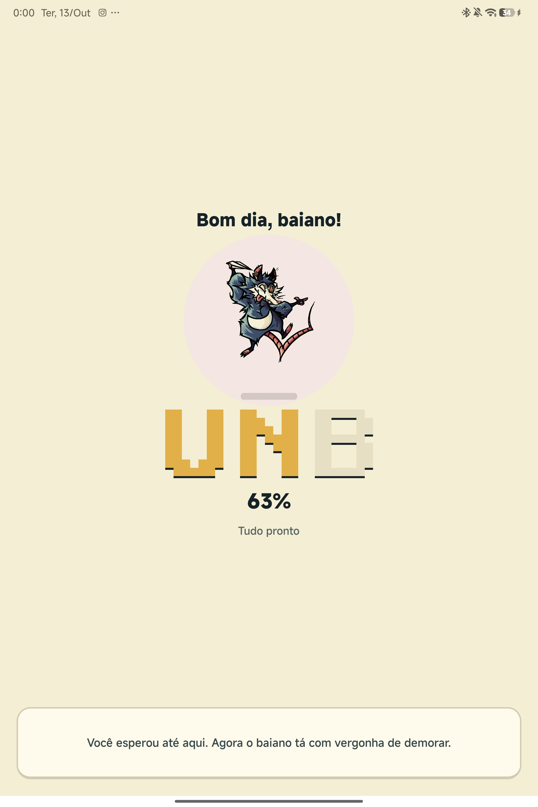
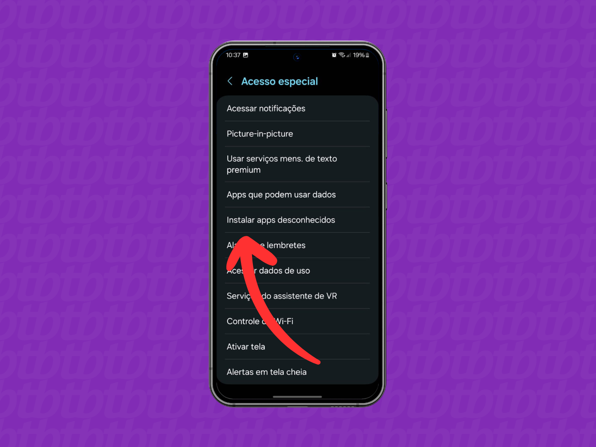
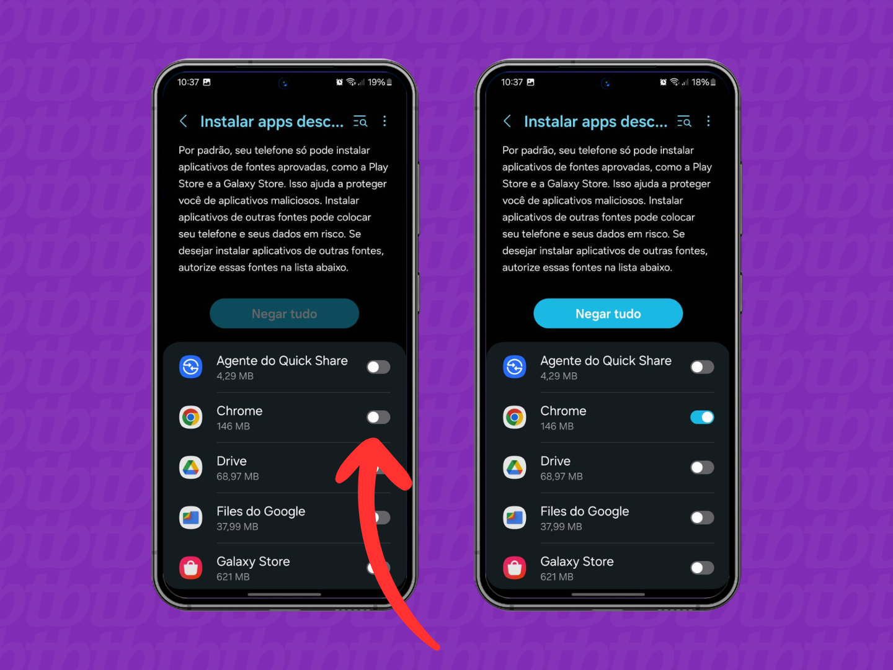

 

  

  # AB.c — Aprendizagem, Barreiras e Computação

  **Aprender a programar é descobrir o que a tecnologia pode fazer. Aprender sobre acessibilidade é descobrir para quem ela deve funcionar.**

  Universidade de Brasília (UnB) · Educação · Gratuito

   

  
  

    

  

   
  Disponível para Android · Instalação via APK

---

## O PROJETO

> A tecnologia pode abrir caminhos, mas também pode criar barreiras. Tudo depende de como ela é pensada.

O **AB.c, Aprendizagem, Barreiras e Computação** nasceu de uma proposta simples: aproximar o ensino de programação de uma questão que nem sempre recebe a atenção que merece, a acessibilidade digital.

Desenvolvido por estudantes da **Universidade de Brasília (UnB)**, para a disciplina de **Informática e Sociedade**, o projeto une computação, educação e inclusão em uma experiência de aprendizagem voltada especialmente para estudantes do ensino médio.

Aqui, aprender programação não se resume a decorar comandos ou descobrir onde está faltando um ponto e vírgula. A proposta é experimentar, resolver problemas e entender como as decisões de quem desenvolve um sistema afetam as pessoas que vão utilizá-lo.

Porque escrever código é apenas parte do trabalho. A outra parte é pensar em quem está do outro lado da tela.

---

## APRENDER FAZENDO

No AB.c, os conceitos de programação aparecem em desafios práticos. Em vez de ficar apenas na teoria, você acompanha situações, investiga problemas e usa a lógica para encontrar soluções.

**O que você vai explorar:**

- **Fundamentos da programação** — Conheça variáveis, tipos de dados, sintaxe e operações lógicas, construindo sua compreensão passo a passo.
- **Decisões e estruturas de controle** — Descubra como condicionais, comparações e eventos permitem que um programa responda a diferentes situações.
- **Acessibilidade digital** — Entenda como contraste, tamanho dos elementos, informações sonoras e outras escolhas podem tornar um sistema mais acessível.
- **Um problema para resolver: a Loja do Tonho** — Entre em um cenário inspirado no cotidiano, investigue dificuldades de uso e aplique seus conhecimentos para melhorar a experiência de quem precisa utilizar o sistema.

Cada desafio conecta o raciocínio computacional a uma situação concreta. A ideia não é apenas descobrir se o código funciona, mas também refletir sobre como ele funciona para as pessoas.

---

## CONHEÇA O AB.c

### Da primeira linha de código a uma experiência mais acessível

  
  
  
  
  

Explore as telas, conheça a proposta e veja como programação e acessibilidade se encontram ao longo dos desafios.

---

## COMO INSTALAR

O AB.c é um projeto acadêmico distribuído gratuitamente em formato APK. Como o aplicativo é instalado diretamente pelo arquivo, e não por uma loja oficial, pode ser necessário autorizar a instalação no Android.

  
  
  
  

1. **Baixe o aplicativo:** clique em **Obter o App** e faça o download do arquivo APK.
2. **Autorize a instalação:** se o Android solicitar, permita a instalação de aplicativos dessa fonte nas configurações do dispositivo.
3. **Instale:** abra o arquivo baixado e confirme a instalação.
4. **Comece a explorar:** abra o AB.c e descubra os desafios.

*Os nomes dos menus podem variar conforme a versão do Android e a fabricante do aparelho.*

---

## FICHA DO APLICATIVO

| Informação | Detalhes |
| :--- | :--- |
| **Nome** | AB.c — Aprendizagem, Barreiras e Computação |
| **Desenvolvimento** | Estudantes da Universidade de Brasília (UnB) |
| **Disciplina** | Informática e Sociedade |
| **Categoria** | Educação · Computação |
| **Plataforma** | Android |
| **Versão mínima** | Android 7.0 ou posterior |
| **Tamanho aproximado** | 65 MB |
| **Idioma** | Português |
| **Preço** | Gratuito |
| **Distribuição** | Arquivo APK |

---

## FALE COM A GENTE

Um projeto de aprendizagem também cresce com as experiências de quem o utiliza.

Encontrou uma dificuldade? Teve uma ideia para um novo desafio? Percebeu algo que poderia ser mais acessível? Sua opinião pode ajudar a melhorar o aplicativo e tornar a experiência mais completa.

**Contato do desenvolvedor:** [redjp15@gmail.com](mailto:redjp15@gmail.com)

---

  ### Sua primeira linha de código pode mudar mais do que você imagina.

  

    

  <b>AB.c — Aprender, Brincar e Codificar.</b>

   
  Um projeto acadêmico da Universidade de Brasília.

